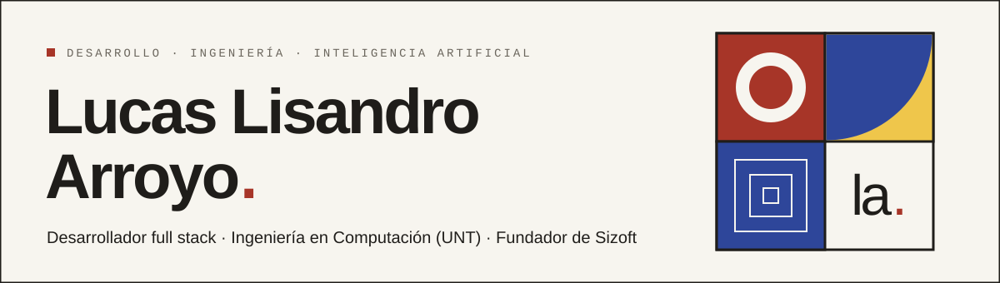

  
  
  
  
  
  

Estudiante de **Ingeniería en Computación** en la FACET (Universidad Nacional de Tucumán) y desarrollador full stack. Construyo software que se usa todos los días en comercios reales: desde el relevamiento con el cliente hasta el despliegue y el soporte.

Fundé **[Sizoft](https://sizoft.com)**, la marca desde la que desarrollo y opero mis productos. Todo empezó en la caja de un bar: digitalicé la facturación en Excel, la convertí en una aplicación y terminó siendo un ERP.

## Productos

| | Proyecto | Qué es | Stack |
|---|---|---|---|
| **01** | **[tumostrador](https://tumostrador.shop)** | ERP para PyMEs argentinas: ventas, caja, stock y facturación electrónica ARCA, sobre una API multi-empresa propia. | JavaScript · Fastify · PostgreSQL |
| **02** | **[ERP Lubricentro](https://github.com/vvintra/erp-lubricentro-descargas/releases)** | Versión de escritorio para lubricentros, con instaladores para Windows y Linux y actualizaciones automáticas desde GitHub. | Escritorio · GitHub Releases |
| **03** | **[ortografin](https://ortografin.lat)** | Iniciativa para que chicos mejoren su tipeo, ortografía y caligrafía. Próximamente como app móvil. | Next.js · React |
| **04** | **[Portafolio](https://github.com/vvintra/Portafolio)** | Mi sitio personal, publicado en Vercel y GitHub Pages. | Next.js · Tailwind CSS |

Además desarrollo **sistemas a medida** para clientes (un corralón de materiales, comercios) y exploro **IA aplicada**: generación de imágenes con modelos de difusión en local (ComfyUI, DirectML) y desarrollo asistido con Claude Code. Antes de eso hacía servicio técnico de PC e impresoras.

## Stack

  
  
  
  
  
  
  
  
  
  
  

  
  
  
  
  
  

## Formación

- **Ingeniería en Computación** — FACET, Universidad Nacional de Tucumán (2021 – actualidad)
- **Certificación Avanzada en Full Stack Developer** — ITBA, 306 h (beca Santander Open Academy, 2024)
- **Argentina Programa** — #SéProgramar (2022) y #YoProgramo Web Full Stack (2023)
- **Deep Reinforcement Learning** — Hugging Face, Certificate of Excellence (2023)
- **Claude Code in Action, Claude Code 101 y Claude 101** — Anthropic Academy (2026)
- *En preparación:* Microsoft Azure AI-901 y Google Cloud Digital Leader

Todas las certificaciones, con sus imágenes y links de verificación, están en el **[portafolio](https://lucas-arroyo-portafolio.vercel.app/#certificates)**.

## Fuera del código

Secretario de Finanzas del Centro de Estudiantes de FACET (2025), organizador de Modelos de Naciones Unidas con Uniendo Metas (2021 – 2023) y practicante de Brazilian Jiu-Jitsu.

---

San Miguel de Tucumán, Argentina · Abierto a proyectos y colaboraciones: <a href="mailto:lucaslisandroarroyo02@gmail.com">lucaslisandroarroyo02@gmail.com</a>
